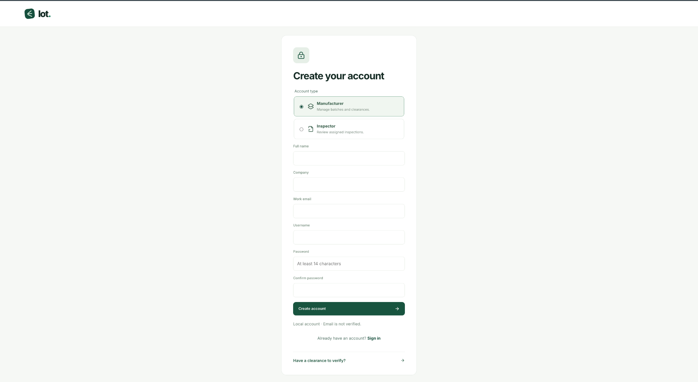
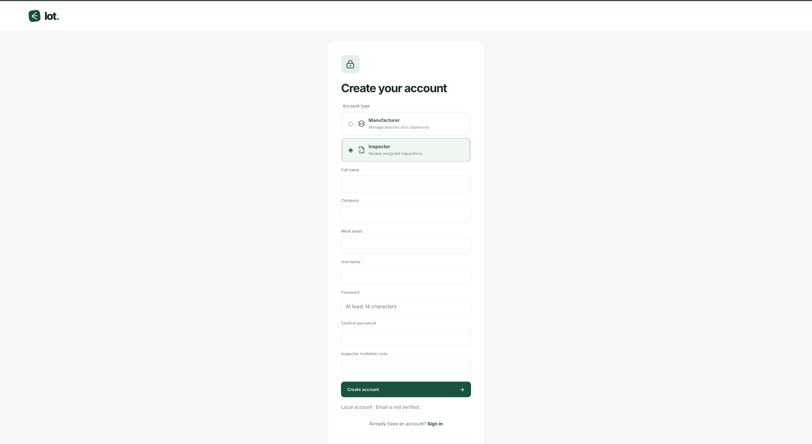
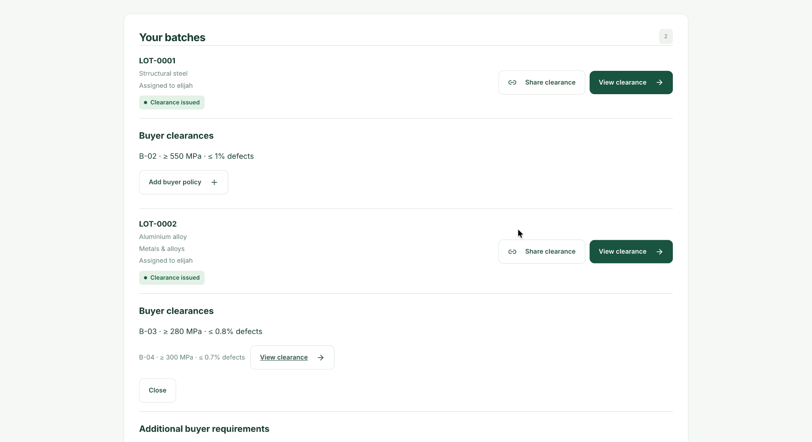
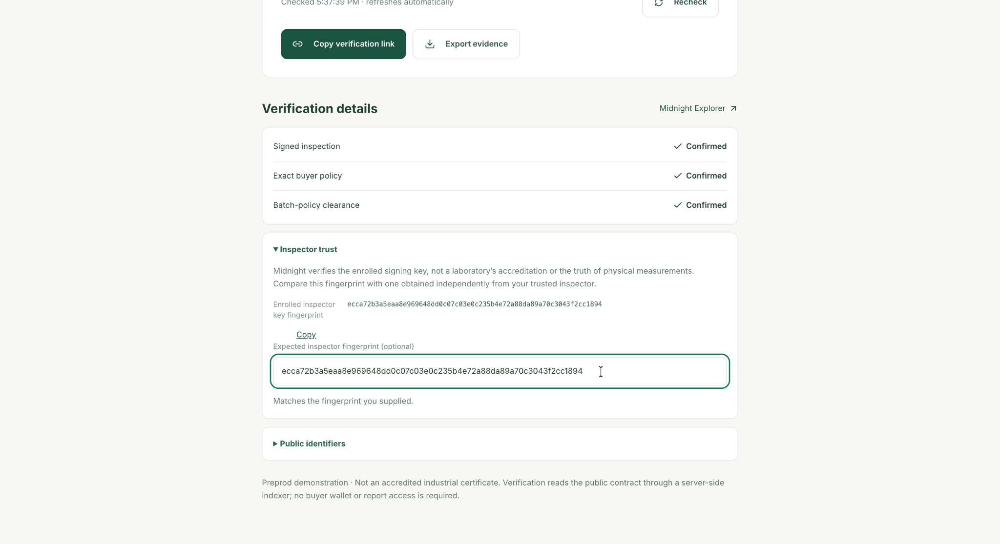
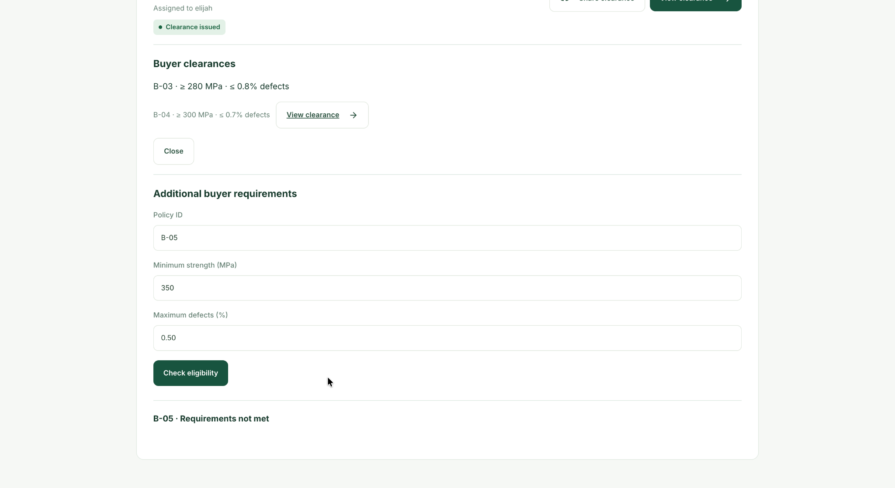
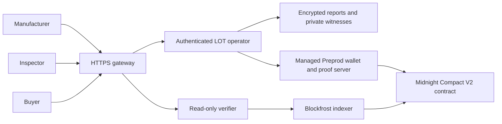

# LOT

**Inspect once. Qualify for multiple buyers. Keep measurements private.**

LOT is a confidential supplier qualification application built on Midnight for the Midnight Buildathon, Wave 3. It helps materials manufacturers turn signed inspection reports into buyer-specific, publicly verifiable clearances without publishing the underlying measurements.

[Open LOT](https://lot-clearance.austriaeast.cloudapp.azure.com/app) · [Verify a clearance](https://lot-clearance.austriaeast.cloudapp.azure.com/) · [Preprod evidence](docs/PREPROD-EVIDENCE.md)

## Why LOT

Procurement teams need evidence that a supplier's materials meet specified quality thresholds. Suppliers may prefer not to disclose exact readings, which can reveal manufacturing performance. A signed report or document hash alone does not prove that the underlying readings satisfy a buyer's requirements. LOT proves that relationship in a Midnight circuit and allows one committed inspection to qualify against multiple policies.

LOT initially supports strength (MPa) and defect rate. Material categories provide descriptive context, not separate industry certification standards.

## Try it

**Manufacturer:** Open LOT, create an account, add a batch and create a single-use inspector invitation. Once a signed report arrives, prepare the buyer's strength and defect-rate requirements and check eligibility.

**Inspector:** Register using an invitation, accept an assigned batch and sign a synthetic inspection report. The service encrypts the private report at rest.

**Buyer:** Open a clearance link from the public verification page. No account or buyer wallet is needed. Check the policy, registered inspection and clearance against the current indexed Midnight state. Use an independently obtained inspector fingerprint to compare the enrolled signing key.

Public accounts can exercise the inspection and eligibility workflow. Actual on-chain issuance uses a dedicated funded Preprod wallet and is limited to explicitly authorized manufacturer accounts with persistent issuance allowances. Existing on-chain receipts are available for anyone to verify. Use synthetic measurements only.

## Demonstration evidence

| Batch | Buyer policy | Minimum strength | Maximum defects | Result |
|---|---|---:|---:|---|
| LOT-3002 | B-02 | 550 MPa | 1% | [Earlier Preprod clearance](https://lot-clearance.austriaeast.cloudapp.azure.com/verify-preprod?batch=LOT-3002) |
| LOT-0001 | B-02 | 550 MPa | 1% | [Verify](https://lot-clearance.austriaeast.cloudapp.azure.com/verify-preprod?key=eee890fa3380b60bf9f08a5c1904dea1ed239566b37bd56ba44db71aac65b7f9) |
| LOT-0002 | B-03 | 280 MPa | 0.8% | [Verify](https://lot-clearance.austriaeast.cloudapp.azure.com/verify-preprod?key=0cbf4ea97a25c0d98713534348de9bb31701052e41b3bdb0fb8049f7a3968123) |
| LOT-0002 | B-04 | 300 MPa | 0.7% | [Verify](https://lot-clearance.austriaeast.cloudapp.azure.com/verify-preprod?key=f86c4070ce4bc0a0e85368a45c017bc3ebcbb0dccdc455d47c45f1fd6e385d13) |
| LOT-0002 | B-05 | 350 MPa | 0.5% | Not eligible in local check; no clearance issued |

B-03 and B-04 reuse the same contract and registered inspection. They have different buyer thresholds and clearance keys. Development logs from November 24 record successful ledger checks for both. Three receipt JSON files are bundled with this checkout; the earlier LOT-3002 target is defined in the public verifier. See [Preprod evidence](docs/PREPROD-EVIDENCE.md) for exact contract addresses, submission identifiers and verification steps. These are development inspections, not accredited certificates.

<details>
<summary>Manufacturer and inspector onboarding</summary>





</details>







Screenshots show the development workflow; the live deployment is linked above.

## Architecture and Midnight integration



The V2 contract, [`contracts/lot-v2.compact`](contracts/lot-v2.compact), contains three state-changing circuits:

| Circuit | Function | Security property |
|---|---|---|
| `registerInspectionSigned` | Register a signed inspection | Verify the enrolled Jubjub Schnorr signing key over the batch and salted commitment; reject duplicate batch |
| `registerPolicy` | Register public buyer requirements | Verify a private policy-admin witness against its public hash; reject duplicate policy |
| `proveClearance` | Prove qualification | Open the existing commitment privately; enforce strength and defect inequalities; reject duplicate clearance |

The public ledger stores the inspector verification key, policy-admin key hash, inspection commitments, buyer thresholds and clearance keys. It does not store exact readings, opening salts or signing secrets. A clearance key is derived from the batch and policy keys. Additional policies can reuse the original inspection without registering it again.

### Privacy and trust boundaries

- Privacy is against buyers and public ledger observers, not against the service operator, which manages inspector signing keys and can decrypt reports.
- The enrolled inspector key is not proof of independent accreditation or physical measurement truth. Fingerprint comparison requires an independently trusted reference.
- The manufacturer enters buyer requirements; buyer-authenticated policy provenance is not implemented. Public thresholds and successful proofs disclose bounds, and repeated policies can narrow those bounds.
- Initial issuance uses a batch-specific contract. Subsequent policies reuse that contract. Material labels are not bound by the V2 circuit.
- The verifier reads indexed contract state; it does not independently validate consensus or reconstruct the entire transaction history.

## Reproduce and evaluate

Development environment: Node.js 22.23.1, Compact toolchain 0.36.1 / compiler 0.5.3, Compact runtime 0.21.0, Midnight.js 5.0.1, Ledger 9. The source includes both lockfiles, generated contract bindings, proof IR and proving/verification keys. See [Midnight developer documentation](https://docs.midnight.network/) for compatible tooling.

From a fresh checkout:

```sh
npm ci --include=dev
npm run test:all
npm run build
VITE_LOT_HOSTED=1 ./node_modules/.bin/vite build --config vite.preprod.config.mjs
```

To reproduce full circuit compilation with the compatible Compact compiler on PATH:

```sh
compact compile contracts/lot.compact contracts/managed/lot
compact compile contracts/lot-v2.compact contracts/managed/lot-v2
npm run test:all
```

November 25: the uploaded release's 330 application tests were rerun independently with zero failures and zero skips. The complete `npm run test:all` command (application tests and both generated-contract simulator suites) also returned exit status 0 on the Azure deployment. The application checks do not require live-chain transactions; live Preprod evidence is documented separately. The V2 full compilation was demonstrated on the development machine on November 24.

### Local product

In terminal 1:

```sh
npm run proof:serve
```

In terminal 2:

```sh
npm run dev -- --config vite.workspace.config.mjs --port 5173 --strictPort
```

Open `http://127.0.0.1:5173/`. Create a manufacturer account and an invitation-based inspector account, submit a synthetic inspection and evaluate buyer requirements. The local eligibility check is not an on-chain clearance. Do not expose these local development servers to the public internet.

### Read-only Preprod verifier

Build the public frontend and start the reader with your own private Preprod Blockfrost project token:

```sh
./node_modules/.bin/vite build --config vite.preprod.config.mjs
read -rs -p 'Preprod Blockfrost token: ' TOKEN; echo
HOST=127.0.0.1 PORT=4176 LOT_PUBLIC_RECEIPTS_DIR="$PWD/public-receipts" \
  BLOCKFROST_PROJECT_ID="$TOKEN" node scripts/lot-preprod-public-server.mjs
unset TOKEN
```

Open `http://127.0.0.1:4176/` and verify an existing public receipt. The command uses Bash; the token is not passed on the command line or stored in the repository.

### Managed issuance and hosting

See [operator setup and deployment](docs/DEPLOYMENT.md) for the bundled wallet bootstrap, proof server, HTTPS services, persistent limits and the current wallet-address configuration constraint. Live issuance needs separately provisioned Preprod funding, registered NIGHT, spendable DUST, a valid wallet checkpoint and an approved manufacturer. No private wallet or server state is distributed.

The Azure deployment has demonstrated issuance from the browser and serves the product over HTTPS. The application and verifier use separate loopback services. A fresh wallet end-to-end issuance walkthrough and a cold server restart acceptance test remain to be verified independently.

## Development progress

| Milestone | Work completed |
|---|---|
| Proof foundation | Private commitments, buyer thresholds and Compact simulation |
| Signed inspections | Circuit-level signature verification, encrypted reports, inspector key enrollment and replay rejection |
| Preprod integration | Ledger 9 wallet integration, checkpoint recovery, deployment, inspection, policy and clearance transactions |
| Product workflow | Manufacturer/inspector accounts, assigned requests, invitations and materials categories |
| Buyer verification | Exact public receipt validation, ledger reads and shareable policy-specific links |
| Browser issuance | Managed authorization, transaction journals, reconciliation and recovery of submission identifiers |
| Multi-buyer qualification | Reuse one inspection across policies, distinct clearances, negative eligibility case |
| Quality and reliability | Regression tests, stale-response protection, issuance reservations and persistent budgets |
| Cloud deployment | Azure-hosted wallet runtime, live browser issuance, HTTPS gateway and persistent services |

## Adoption and roadmap

Initial target users are materials manufacturers, testing laboratories and procurement teams. A pilot would evaluate whether buyer-specific clearances reduce repeated report requests and unnecessary disclosure. A potential business model is a manufacturer subscription or clearance allowance with free buyer verification. No independent customers, accreditation, commercial validation or production-scale availability are claimed. Future work includes independent inspector keys, buyer-authenticated policies, accredited enrollment, revocation, richer measurement types and scalable issuance.

## Licensing

LOT's Buildathon-developed code is released under [Apache-2.0](LICENSE). Upstream Midnight example helpers retain their original copyright and license headers. See [NOTICE](NOTICE) for provenance. Third-party dependencies retain their own licenses. See [SECURITY.md](SECURITY.md) for deployment limitations and responsible reporting.
